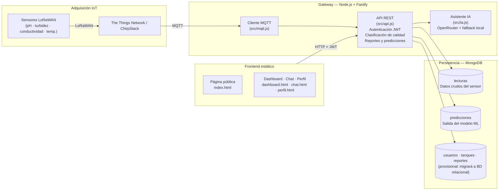
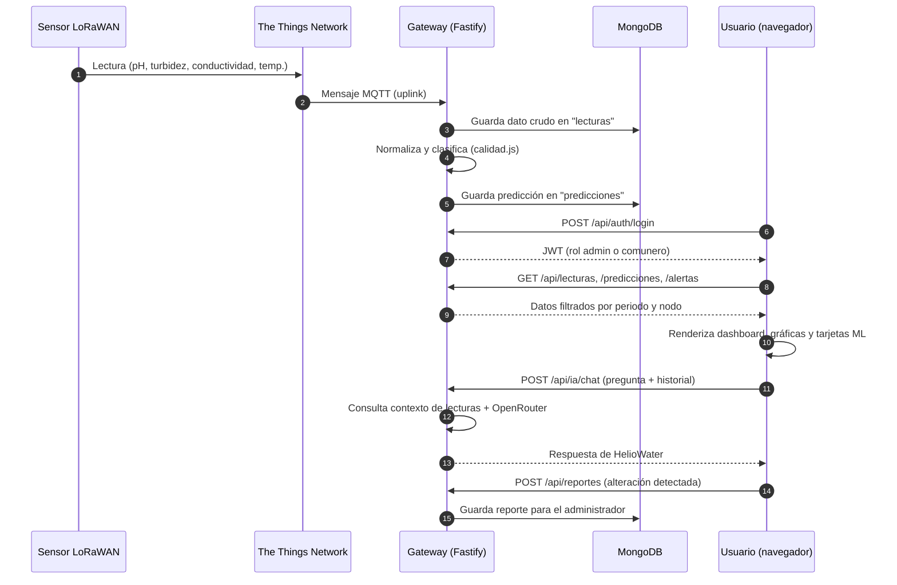

# WaterMLdetect — Monitoreo de Calidad del Agua

Sistema web de monitoreo de calidad del agua para comunidades. Recibe lecturas de sensores fisicoquímicos (pH, turbidez, conductividad y temperatura), las clasifica con un modelo predictivo, genera alertas y las presenta en un dashboard público y autenticado, junto con un asistente de IA (HelioWater) para interpretar los datos.

Desarrollado con **Helio Mind Labs** y un equipo de investigadores.

---

## Tabla de contenido

1. [Características](#características)
2. [Arquitectura](#arquitectura)
3. [Estructura del proyecto](#estructura-del-proyecto)
4. [Flujo de funcionamiento](#flujo-de-funcionamiento)
5. [Ejecución rápida](#ejecución-rápida)
6. [Modo demo](#modo-demo)
7. [Configuración (variables de entorno)](#configuración-variables-de-entorno)
8. [Roles y permisos](#roles-y-permisos)
9. [API REST](#api-rest)
10. [Base de datos](#base-de-datos)
11. [Asistente IA](#asistente-ia)
12. [Pruebas](#pruebas)
13. [Parámetros monitoreados](#parámetros-monitoreados)
14. [Notas](#notas)

---

## Características

- **Página pública** (`index.html`): estado actual del agua por tanque, gráfica de tendencia de 7 días y resumen general, sin necesidad de iniciar sesión ni exportar datos.
- **Dashboard autenticado** (`dashboard.html`): métricas en tiempo real, gráficas de 24 h y tendencias, centro de alertas, historial de lecturas con filtros por periodo (24 h, 7 días, 30 días, 1 año o rango personalizado), estado de la red LoRaWAN y reportes de la comunidad.
- **Predicciones ML**: vista dedicada con la salida del modelo Random Forest — clase predicha por tanque, distribución por periodo y filtros por fecha y nodo.
- **Asistente IA HelioWater** (`chat.html`): chat de pantalla completa para todos los usuarios autenticados, con historial de conversación y respuestas breves y precisas.
- **Gestión de usuarios**: registro, inicio de sesión, edición de perfil y cambio de contraseña.
- **Reportes de alteraciones**: cualquier usuario puede avisar al administrador cuando un parámetro se sale de rango; el administrador los gestiona y cambia su estado.
- **Exportación CSV**: disponible únicamente para el rol administrador.
- **Diseño responsive** y accesible, con iconografía SVG propia y estados visuales verde/amarillo/rojo según la calidad del agua.

---

## Arquitectura

El sistema sigue una arquitectura cliente-servidor simple: un **gateway Node.js (Fastify)** sirve el frontend estático y expone la API REST en el mismo origen. La adquisición de datos llega por **MQTT** (The Things Network / ChirpStack) o por la ruta HTTP `/api/sensor/registrar`, y se persiste en **MongoDB**.



**Decisiones clave:**

| Decisión | Motivo |
|---|---|
| Gateway único (API + estáticos) | Un solo proceso y un solo puerto simplifican despliegue y desarrollo |
| Colección `predicciones` separada de `lecturas` | Los datos crudos del sensor nunca se mezclan con la salida del modelo; cada predicción guarda sus entradas para auditoría |
| Clasificación en el backend | El umbral/Random Forest se aplica al guardar, así todos los clientes ven el mismo resultado |
| JWT en `sessionStorage` | Sesión que no persiste al cerrar la pestaña del navegador |

---

## Estructura del proyecto

```
monitoreoCalidadDeAgua/
│
├── frontend/                     # Sitio web estático (HTML + CSS + JS, sin framework)
│   ├── index.html                # Página pública: estado del agua y tendencias
│   ├── login.html                # Inicio de sesión
│   ├── registro.html             # Creación de cuenta
│   ├── dashboard.html            # Panel autenticado (métricas, alertas, ML, reportes)
│   ├── chat.html                 # Chat de pantalla completa con HelioWater
│   ├── perfil.html               # Edición de perfil y contraseña
│   ├── app/
│   │   ├── index.js              # Lógica principal: sesión, dashboard, filtros, reportes, predicciones
│   │   ├── chat.js               # Chat con la IA (flotante y página completa)
│   │   ├── perfil.js             # Formulario de perfil
│   │   └── grafica.js            # Gráficas Chart.js del dashboard
│   ├── styles/styles.css         # Sistema de diseño completo (tema claro profesional)
│   └── vendor/chart.umd.js       # Chart.js servido localmente (sin CDN)
│
├── gateway/                      # Backend Node.js + Fastify
│   ├── src/
│   │   ├── index.js              # Arranque del servidor y registro de rutas
│   │   ├── api.js                # Rutas REST: tanques, lecturas, predicciones, alertas, IA
│   │   ├── auth.js               # Registro, login JWT, roles (admin/comunero), perfil
│   │   ├── calidad.js            # Umbrales y clasificación de calidad del agua
│   │   ├── lecturasRepository.js # Persistencia de lecturas crudas en MongoDB
│   │   ├── prediccionesRepository.js # Colección "predicciones" del modelo ML
│   │   ├── reportes.js           # Reportes de alteraciones enviados por usuarios
│   │   ├── db.js                 # Conexión a MongoDB
│   │   ├── mqtt.js               # Suscripción al broker MQTT (TTN)
│   │   ├── ttnSensor.js          # Ruta HTTP de registro directo del sensor
│   │   ├── simulador.js          # Datos demo generados cuando DEMO_MODE=true
│   │   ├── ia.js                 # Integración con OpenRouter y fallback local
│   │   └── env.js                # Carga de variables de entorno
│   ├── prompts/
│   │   └── asistente_agua.md     # Prompt del sistema de HelioWater
│   ├── test/                     # Pruebas con node:test
│   ├── .env / .env.example       # Configuración (el .env está ignorado por Git)
│   └── package.json
│
└── README.md
```

---

## Flujo de funcionamiento

Así viaja un dato desde el sensor hasta la pantalla del usuario:



**Puntos clave del flujo:**

- Las lecturas crudas y las predicciones del modelo se escriben en **colecciones separadas** en el mismo evento de ingesta.
- La página pública (`/api/publico/estado`) no pide token y solo devuelve resúmenes, nunca datos exportables.
- En `DEMO_MODE=true` los pasos 1–5 se simulan en memoria y nada se escribe en MongoDB.
- Si OpenRouter falla, el asistente responde con el análisis local sin interrumpir el servicio.

---

## Ejecución rápida

El gateway sirve el frontend y la API en el mismo puerto (`http://localhost:4000`).

```bash
cd gateway
npm install   # solo la primera vez
npm run dev   # modo watch: recarga solo al guardar cambios
```

Abre `http://localhost:4000` en el navegador.

**Otros comandos** (desde `gateway/`):

```bash
npm start   # producción, sin watch
npm test    # pruebas del gateway
```

> Si el puerto 4000 está ocupado por un proceso anterior, libéralo con:
> `Get-NetTCPConnection -LocalPort 4000 -State Listen | Select-Object -ExpandProperty OwningProcess | ForEach-Object { Stop-Process -Id $_ -Force }`

---

## Modo demo

Con `DEMO_MODE=true` en `gateway/.env` el sistema funciona **sin MongoDB, MQTT ni sensores**: genera dos tanques y una semana de lecturas simuladas en cada consulta, sin persistir nada.

- Login admin: `demo@watermldetect.com` / `Agua2026!`
- El modo queda marcado como `simulacion` en `GET /api/health`.
- Para crear un usuario comunero usa **Crear mi cuenta** en el login.

---

## Configuración (variables de entorno)

Archivo: `gateway/.env` (nunca se sube a Git; ver `.env.example`).

| Variable | Descripción |
|---|---|
| `DEMO_MODE` | `true` = simulación sin MongoDB/MQTT |
| `MONGO_URL` / `MONGO_URI` | Cadena de conexión a MongoDB (modo real) |
| `MONGO_DB` | Nombre de la base de datos (por defecto `Monitoreo_Agua`) |
| `MQTT_URL`, `MQTT_USERNAME`, `MQTT_PASSWORD` | Conexión al broker MQTT |
| `TTN_TOPIC` | Tópico de The Things Network al que suscribirse |
| `TOKEN_SECRET` | Secreto para firmar los JWT (mínimo 32 caracteres) |
| `TOKEN_TTL` | Duración del token |
| `ADMIN_EMAIL` | Correo que recibe automáticamente el rol **admin** al iniciar sesión |
| `OPENROUTER_API_KEY` | Clave de OpenRouter para el asistente IA |
| `OPENROUTER_MODEL` | Modelo principal (por defecto `google/gemini-3.5-flash-lite`) |
| `OPENROUTER_FALLBACK_MODELS` | Modelos alternativos si el principal falla |
| `LLM_URL` | Servidor compatible con OpenAI opcional |

---

## Roles y permisos

| Acción | Admin | Comunero |
|---|---|---|
| Ver dashboard, gráficas y alertas | ✔ | ✔ |
| Ver predicciones ML | ✔ | ✔ |
| Usar el asistente IA | ✔ | ✔ |
| Editar perfil y contraseña | ✔ | ✔ |
| Reportar alteración del agua | ✔ | ✔ |
| Exportar lecturas a CSV | ✔ | — |
| Gestionar reportes de la comunidad | ✔ | — |

El rol se asigna por el correo configurado en `ADMIN_EMAIL`; el resto de usuarios registran rol `comunero`.

---

## API REST

Base: `http://localhost:4000/api`. Todas las rutas privadas requieren `Authorization: Bearer <token>`.

| Método | Ruta | Descripción |
|---|---|---|
| GET | `/health` | Estado del servicio, modo y proveedor de IA |
| GET | `/publico/estado` | Estado por tanque + tendencia de 7 días (público, sin exportación) |
| POST | `/auth/registro` | Crear cuenta comunero |
| POST | `/auth/login` | Iniciar sesión → `{token, usuario}` |
| GET | `/auth/perfil` | Datos del usuario en sesión |
| PUT | `/auth/perfil` | Editar nombre, teléfono, vereda y contraseña |
| GET | `/tanques` | Lista de tanques/nodos monitoreados |
| GET | `/lecturas?nodoId&desde&hasta&limite` | Lecturas crudas de sensores |
| GET | `/predicciones?nodoId&desde&hasta&limite` | Predicciones del modelo ML (colección separada) |
| GET | `/alertas` | Alertas generadas en los últimos 7 días |
| GET | `/ia/reporte?nodoId` | Explicación y recomendaciones de la última lectura |
| POST | `/ia/chat` | Chat con HelioWater `{nodoId, pregunta, historial[]}` |
| POST | `/reportes` | Enviar reporte de alteración (cualquier usuario) |
| GET | `/reportes` | Listar reportes (solo admin) |
| PATCH | `/reportes/:id` | Cambiar estado de un reporte (solo admin) |
| POST | `/registrar` | Registro directo de lecturas desde el sensor HTTP (modo real) |
| GET | `/mapa` | Última lectura recibida por MQTT |

---

## Base de datos

El sistema usa **dos colecciones principales** en MongoDB (`MONGO_DB`, por defecto `Monitoreo_Agua`):

| Colección | Contenido |
|---|---|
| `lecturas` | Datos crudos del sensor: `sensorId`, `recibidoEn`, `datos{}`, RSSI/SNR/batería |
| `predicciones` | Salida del modelo ML: `nodoId`, `fecha`, `clase`, `confianza`, `modelo`, `entradas{}` |

La colección `predicciones` está **separada** de `lecturas` a propósito: los datos crudos del sensor nunca se mezclan con la salida del modelo, y cada predicción guarda las entradas que la produjeron para auditoría.

**Datos provisionales en MongoDB:** las colecciones `usuarios`, `tanques` y `reportes` existen por ahora en la misma base, pero están previstas para migrar a una **base de datos relacional independiente** en una etapa posterior del proyecto.

Cada lectura nueva que entra por MQTT o por `/registrar` genera automáticamente un documento en `predicciones` con la clase resultante y las entradas que la produjeron.

---

## Asistente IA

HelioWater responde preguntas sobre la calidad del agua usando el prompt de `gateway/prompts/asistente_agua.md` y el contexto de las últimas 24 h de lecturas.

1. Crea una clave en <https://openrouter.ai/keys>.
2. Configura `OPENROUTER_API_KEY` y `OPENROUTER_MODEL` en `gateway/.env`.
3. Si OpenRouter falla o no hay clave, el asistente usa un análisis local por reglas, sin interrumpir el servicio.

El modelo principal consume crédito de OpenRouter (fracciones de centavo por respuesta). La clave vive solo en `gateway/.env`, que Git ignora.

---

## Pruebas

```bash
cd gateway
npm test
```

Las pruebas cubren la entrega del frontend, la salud de la API, la autenticación, la normalización de lecturas TTN, el chat y el reporte de IA — todo sin necesitar MongoDB.

---

## Parámetros monitoreados

| Parámetro | Unidad | Rango seguro |
|---|---|---|
| pH | — | 6.5 – 8.5 |
| Turbidez | NTU | < 5 |
| Conductividad | µS/cm | 100 – 1000 |
| Temperatura | °C | 10 – 30 |

La clasificación resultante es **Buena**, **Aceptable**, **Riesgo** o **No apta**, calculada con los umbrales de `gateway/src/calidad.js` (reemplazo actual del Random Forest; cuando el modelo real esté integrado, `prediccionesRepository.js` guardará también su confianza).

---

## Notas

- El frontend consume la API del mismo origen; no requiere build ni dependencias de frontend.
- Chart.js se sirve localmente desde `frontend/vendor/` para que las gráficas funcionen sin internet.
- El estado público del index es una vista general: no permite exportar datos ni ver el detalle por tanque.
- La clasificación es una evaluación predictiva y **no reemplaza los análisis de laboratorio oficiales**.

---

## Licencia y autoría

© 2026 **Helio Mind Labs** · Equipo de investigadores.

Todos los derechos reservados. Este proyecto, su código fuente, diseño de arquitectura y documentación son propiedad de Helio Mind Labs. Queda prohibida su reproducción, distribución o uso comercial sin autorización expresa del equipo.
