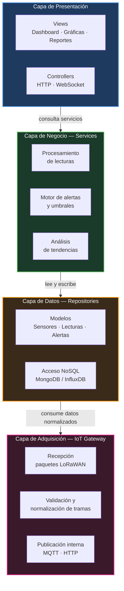
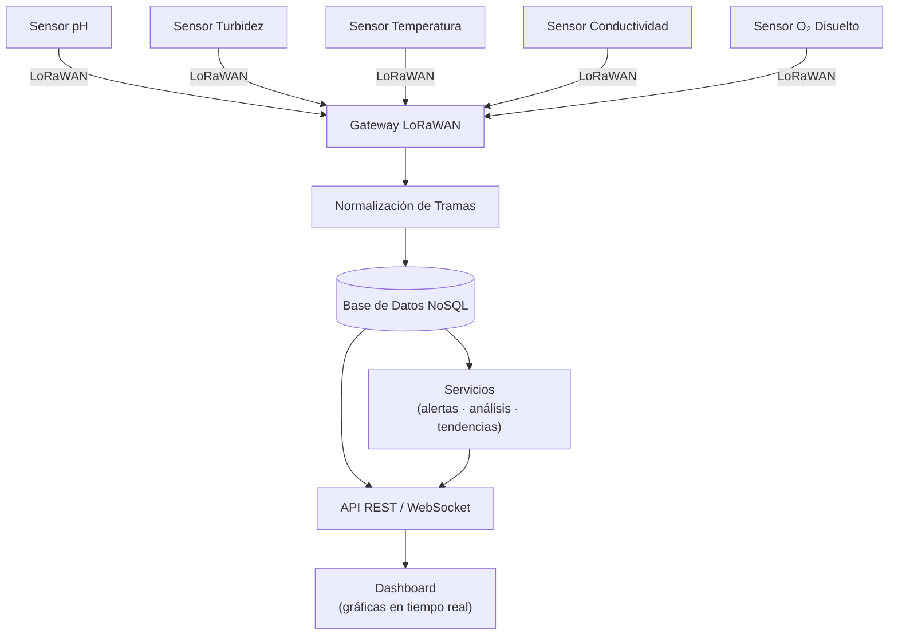

# 💧 Water Quality Sensors — Sistema de Monitoreo de Calidad del Agua

Sistema de telemetría de baja potencia basado en **LoRaWAN** para el monitoreo en tiempo real de parámetros críticos del agua. Captura datos desde sensores sumergibles, los transmite de forma inalámbrica, los almacena en una base de datos NoSQL y los representa visualmente en un dashboard interactivo.

---

## Descripción General

El sistema está diseñado para cubrir tres responsabilidades principales:

1. **Captura de datos** — recibe lecturas desde sensores físicos vía red LoRaWAN.
2. **Persistencia y organización** — almacena y gestiona la información en una base de datos NoSQL.
3. **Representación gráfica** — presenta los datos procesados en un dashboard con alertas y tendencias.

---

## Ejecución rápida

El gateway sirve el frontend y la API en el mismo puerto (`http://localhost:4000`). Solo necesitas un comando:

```bash
cd gateway
npm install   # solo la primera vez
npm run dev   # modo watch: recarga solo al guardar cambios
```

Luego abre `http://localhost:4000` en el navegador.

**Modo demo** (sin MongoDB, MQTT ni sensores — ya configurado en `gateway/.env`):

- Login admin: `demo@watermldetect.com` / `Agua2026!`
- Para crear un usuario comunero usa **Crear mi cuenta** en el login.

**Otros comandos:**

```bash
npm start        # producción (sin watch), desde gateway/
npm test         # pruebas del gateway, desde gateway/
```

---

## Arquitectura del Sistema

Se aplica una **Arquitectura en Capas (Layered Architecture)** con el patrón **MVC** en la capa de presentación. Este enfoque permite separar claramente las responsabilidades, facilitar el mantenimiento y escalar cada capa de forma independiente.



### ¿Por qué esta arquitectura?

| Criterio | Decisión |
|---|---|
| Separación de responsabilidades | Cada capa tiene un rol único y no se mezclan con las demás |
| Escalabilidad | Cada capa puede crecer o reemplazarse sin romper las otras |
| IoT + Web en el mismo sistema | La capa de adquisición desacopla el hardware del resto del software |
| Representación gráfica | MVC en presentación mantiene limpio el manejo de vistas y datos |

---

## Estructura de Carpetas

```
waterQualitySensors/
│
├── acquisition/              # Capa de adquisición (IoT Gateway)
│   ├── lorawan_listener.js   # Escucha y recibe paquetes LoRaWAN
│   ├── payload_parser.js     # Decodifica y valida las tramas de los sensores
│   └── mqtt_publisher.js     # Publica los datos normalizados internamente
│
├── data/                     # Capa de datos
│   ├── models/               # Definición de esquemas (sensores, lecturas, alertas)
│   └── repositories/         # Acceso y consultas a la base de datos NoSQL
│
├── services/                 # Capa de negocio
│   ├── reading_service.js    # Lógica de procesamiento de lecturas
│   ├── alert_service.js      # Evaluación de umbrales y generación de alertas
│   └── trend_service.js      # Cálculo de tendencias y estadísticas
│
├── presentation/             # Capa de presentación (MVC)
│   ├── controllers/          # Controladores HTTP / WebSocket
│   ├── views/                # Plantillas o componentes del dashboard
│   └── routes/               # Definición de rutas de la API y UI
│
├── config/                   # Configuración del sistema (DB, red, umbrales)
├── tests/                    # Pruebas unitarias e integración
└── README.md
```

---

## Parámetros Monitoreados

Los sensores sumergibles capturan los siguientes parámetros:

| Parámetro | Unidad | Descripción |
|---|---|---|
| pH | — | Nivel de acidez o alcalinidad del agua |
| Turbidez | NTU | Claridad del agua |
| Temperatura | °C | Temperatura del cuerpo de agua |
| Conductividad | µS/cm | Concentración de sales disueltas |
| Oxígeno Disuelto | mg/L | Nivel de oxígeno disponible en el agua |

---

## Flujo de Datos



---

## Tecnologías (propuestas)

| Componente | Tecnología sugerida |
|---|---|
| Gateway LoRaWAN | The Things Network (TTN) / ChirpStack |
| Backend | Node.js / Python (FastAPI) |
| Base de datos | MongoDB o InfluxDB (series de tiempo) |
| Mensajería interna | MQTT (Mosquitto) |
| Dashboard | Grafana / React + Chart.js |
| API | REST + WebSocket |

---

## Estado del Proyecto
### 1 cuando ya se esta trabajando, 0 cuando no se a  implementado

- [1] Definición de arquitectura
- [1] Configuración del gateway LoRaWAN
- [1] Modelos de datos y repositorios
- [0] Servicios de procesamiento y alertas
- [0] API REST y WebSocket
- [0] Dashboard de visualización
- [0] Pruebas e integración

---

## Notas

- La base de datos NoSQL se elige por su flexibilidad ante estructuras de datos variables provenientes de distintos tipos de sensores.
- Si la prioridad es análisis temporal (series de tiempo), **InfluxDB** es preferible sobre MongoDB.
- El sistema está diseñado para ser **extensible**: agregar nuevos tipos de sensores o nuevas vistas no requiere modificar las capas subyacentes.

---

## Licencia y Autoría

© 2026 **waterQualitySensors** 

Todos los derechos reservados. Este proyecto, su código fuente, diseño de arquitectura y documentación son propiedad de helioMind Labs. Queda prohibida su reproducción, distribución o uso comercial sin autorización expresa por el equipo.

---

## Ejecución integrada (frontend + gateway)

El gateway Fastify sirve el sitio y su API en el mismo origen, por defecto en `http://localhost:4000`.

### Simulación para presentaciones (sin sensores, MongoDB ni MQTT)

En `gateway/.env`, pon `DEMO_MODE=true`, arranca con `npm run dev` desde `gateway` y abre `http://localhost:4000`. Inicia sesión con `demo@watermldetect.com` y la contraseña `Agua2026!`. Se mostrarán dos tanques y una semana de lecturas generadas; el modo se marca como **simulación** en `/api/health` y no escribe datos en MongoDB. Para volver al modo real, cambia `DEMO_MODE=false` y configura las conexiones de abajo.

### Asistente con OpenRouter

El reporte y el chat usan el prompt guardado en `gateway/prompts/asistente_agua.md`. Ese archivo le indica al modelo que interprete los registros como una consulta a la base de datos, que varíe la redacción en cada respuesta y que no invente valores.

1. Crea una clave en <https://openrouter.ai/keys>.
2. En `gateway/.env`, agrega `OPENROUTER_API_KEY=sk-or-v1-...` y el modelo que quieras usar en `OPENROUTER_MODEL`. Por defecto se usa `google/gemini-3.5-flash-lite`, un modelo económico y rápido. Si el principal falla o está saturado, se prueban los modelos de `OPENROUTER_FALLBACK_MODELS` (`upstage/solar-mini4,openrouter/free` por defecto).
3. Reinicia el gateway. En `/api/health` verás el proveedor y el modelo activos.
4. Si la clave falla, se agota la cuota o no hay internet, el asistente responde automáticamente con el análisis local, sin romper la demostración.

El modelo principal consume crédito de OpenRouter (fracciones de centavo por respuesta). Revisa tu saldo antes de la presentación. Si prefieres no gastar, cambia `OPENROUTER_MODEL` por un modelo terminado en `:free`, aunque suelen tener límites temporales más estrictos.

La clave vive solo en `gateway/.env`, que Git ignora. No la escribas en el README ni en el código. Si no configuras OpenRouter, el asistente sigue funcionando con reglas locales.

1. En `gateway/.env`, configura `MONGO_URL`, `MQTT_URL`, `MQTT_USERNAME` y `MQTT_PASSWORD`. Define también un `TOKEN_SECRET` aleatorio de al menos 32 caracteres. No compartas ni subas este archivo.
2. Desde la carpeta `gateway`, instala dependencias con `npm install`.
3. Arranca el servicio con `npm run dev` y abre `http://localhost:4000`.
4. Crea una cuenta desde **Crear mi cuenta**. Las cuentas y lecturas se guardan en MongoDB.
5. Ejecuta `npm test` desde `gateway` para probar la entrega del frontend, la salud de la API, la autenticación básica y la normalización de lecturas sin necesitar MongoDB.

El frontend usa datos reales (modo demo desactivado). Las rutas privadas disponibles son `POST /api/auth/registro`, `POST /api/auth/login`, `GET /api/tanques`, `GET /api/lecturas`, `GET /api/alertas`, `GET /api/ia/reporte` y `POST /api/ia/chat`. El asistente usa OpenRouter si existe `OPENROUTER_API_KEY`; si no, cae en reglas locales o en un servidor compatible con OpenAI configurado con `LLM_URL`.

El gateway espera los parámetros `ph`, `turbidez`, `conductividad` y `temperature` (o `temperatura`) dentro del `decoded_payload` de TTN. Confirma que los nombres coincidan con el decoder real del sensor.
